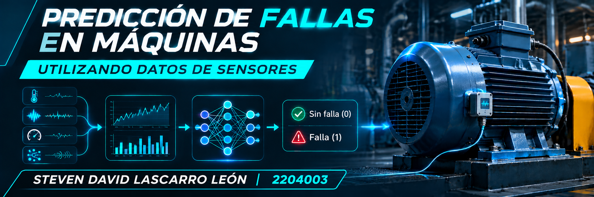

# Predicción de fallas en máquinas utilizando datos de sensores

## Objetivo
Analizar datos de sensores y desarrollar modelos para clasificar registros según la variable `fail` (0 = no falla, 1 = falla). Como etapa adicional, se exploran agrupamientos no supervisados con PCA, K-Means y DBSCAN.

## Autor
- Steven David Lascarro León
- Código: 2204003

## Dataset
El notebook trabaja con un archivo CSV de 944 registros y 10 columnas. Incluye nueve variables predictoras:
`footfall`, `tempMode`, `AQ`, `USS`, `CS`, `VOC`, `RP`, `IP`, `Temperature`
y la variable objetivo `fail`.

**Ubicación usada en Google Colab:** `/content/drive/MyDrive/IA_2026-2/ProyectoIA.csv`

- URL del dataset: https://www.kaggle.com/datasets/umerrtx/machine-failure-prediction-using-sensor-data
- URL del video: https://youtu.be/PAXUSwal2bk

## Etapas del proyecto

### 1. Exploración y preparación
- Exploración de estructura y estadísticas.
- Revisión de nulos, duplicados y valores atípicos mediante IQR.
- Particionado 80/20 para clasificación supervisada.

### 2. Clasificación supervisada
- Decision Tree: `max_depth = 1`.
- Random Forest: `n_estimators = 50`.
- SVM: comparación de kernels `linear`, `poly` y `rbf`; se seleccionó `linear`.
- Deep Learning: MLP con arquitecturas de 3, 6 y 10 capas y experimentos de 5, 10, 50 y 100 épocas.
- Evaluación con Accuracy, Precision, Recall/TPR, TNR y F1 Score.

Resultados de prueba registrados:
| Modelo | Accuracy | F1 Score |
|---|---:|---:|
| Decision Tree | 0.9153 | 0.9024 |
| Random Forest | 0.9153 | 0.9000 |
| SVM | 0.9259 | 0.9146 |
| Deep Learning | 0.9206 | 0.9080 |

### 3. Aprendizaje no supervisado
- StandardScaler.
- PCA con 2 componentes (40.66 % de varianza acumulada).
- K-Means con 2 clusters (403 y 541 registros).
- DBSCAN con `eps = 0.377` y `min_samples = 15`; 2 clusters, 146 registros de ruido y Silhouette 0.3772.

